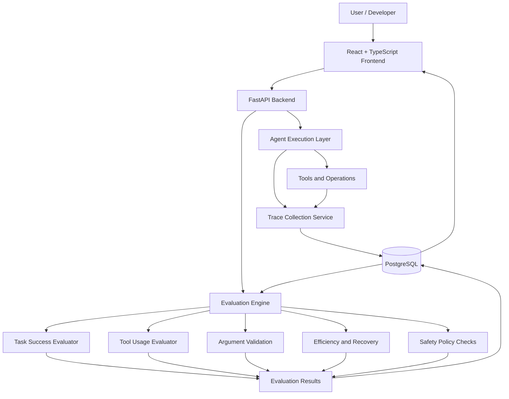

# AgentGuard 🛡️

### AI Agent Evaluation & Observability Platform

**Don't just trust an AI agent's final answer. Inspect its actions, evaluate its decisions, and measure its execution.**

AgentGuard is an AI agent evaluation and observability platform designed to analyze what happens during agent execution. It captures execution traces, records tool interactions, and evaluates whether an agent completed a task correctly, safely, and efficiently.

Traditional applications are often evaluated using input-output comparisons. AI agents require deeper inspection because they can invoke tools, encounter errors, retry operations, and produce convincing answers despite failing to accomplish the intended task.

AgentGuard aims to bridge this gap through **execution tracing, evidence-based evaluation, and configurable policy checks**.

## Table of Contents

- [Problem Statement](#problem-statement)
- [Key Features](#key-features)
- [Architecture](#architecture)
- [Technology Stack](#technology-stack)
- [Project Phases](#project-phases)
- [Getting Started](#getting-started)
- [API Reference](#api-reference)
- [Example Workflow](#example-workflow)
- [Evaluation Methodology](#evaluation-methodology)
- [Project Structure](#project-structure)
- [Current Status](#current-status)
- [Roadmap](#roadmap)
- [Limitations](#limitations)
- [Contributing](#contributing)
- [Author](#author)

## Problem Statement

An AI agent can claim that it completed a task without actually achieving the intended result.

During execution, an agent may:

- Select an inappropriate tool.
- Supply invalid tool arguments.
- Repeat unnecessary operations.
- Fail to recover from errors.
- Violate configured permissions.
- Produce a successful-looking response despite an unsuccessful task.

Inspecting only the final response hides these execution details.

AgentGuard addresses this problem by recording observable execution events and evaluating them against explicit criteria and policies.

**The objective is to move from "the agent says it succeeded" to "the available evidence supports whether it succeeded."**

## Key Features

### Execution Observability
- Persistent traces for agent task executions.
- Ordered spans and execution events.
- Parent-child relationships between operations.
- Tool invocation inputs and outputs, subject to redaction.
- Execution durations, errors, and retry information.
- Trace retrieval through REST APIs.

### Evidence-Based Evaluation
- Task success and outcome validation.
- Tool selection checks.
- Tool argument validation.
- Execution efficiency analysis.
- Error recovery evaluation.
- Configurable safety and permission policies.

### Evaluation Management
- Configurable evaluation criteria and weightings.
- Persisted evaluation results and findings.
- Individual evaluator score breakdowns.
- Overall evaluation status.
- Historical evaluation retrieval.

### Developer Experience
- React-based trace explorer.
- Evaluation dashboard.
- FastAPI REST endpoints.
- PostgreSQL persistence.
- Docker Compose development environment.

## Architecture

The following diagram illustrates the core architecture and intended data flow.



The trace collection service captures execution evidence. The evaluation engine analyzes persisted traces and produces structured findings that can be inspected through the frontend and API.

## Technology Stack

| Component | Technology |
|---|---|
| Backend | Python, FastAPI |
| Frontend | React, TypeScript, Vite |
| Database | PostgreSQL 16 |
| ORM / Database Access | SQLAlchemy, psycopg |
| Containerization | Docker, Docker Compose |
| API Documentation | FastAPI / OpenAPI |
| Version Control | Git, GitHub |

The repository's dependency files and configuration define the exact versions and integrations used by the implementation.

## Project Phases

### Phase 1 — Foundation

Established the initial application infrastructure.

- FastAPI backend.
- React + TypeScript + Vite frontend.
- PostgreSQL 16 with persistent storage.
- Docker Compose orchestration.
- Environment-based configuration.
- API health and readiness endpoints.
- Browser-to-API-to-database connectivity verification.

### Phase 2 — Agent and Tool Execution

Introduced the agent and tool execution capabilities that the observability system is designed to inspect.

The exact runtime and supported tools depend on the repository implementation.

### Phase 3 — Execution Tracing

Implemented persistent execution tracing and trace inspection.

- Trace and span persistence.
- Ordered execution events.
- Parent-child span relationships.
- Payload sanitization and secret redaction.
- Trace listing, filtering, pagination, and detail retrieval.
- Demo endpoints for successful and failed execution paths.
- React trace explorer with execution timelines and payload inspection.

### Phase 4 — Evaluation Engine

Introduced evidence-based evaluation of persisted traces.

| Evaluator | Purpose |
|---|---|
| Task success | Checks whether defined task criteria were satisfied. |
| Tool selection | Evaluates tool usage against configured expectations and policies. |
| Argument validation | Checks recorded arguments against available schemas and criteria. |
| Efficiency | Analyzes execution duration, tool calls, retries, and configured limits. |
| Error recovery | Examines failures, retries, and subsequent outcomes. |
| Safety and permissions | Evaluates recorded actions against configured policies. |

The evaluation engine stores findings, score breakdowns, configuration information, and overall results for later inspection.

Evaluation results depend on the quality and completeness of the recorded evidence.

## Getting Started

### Prerequisites

- [Docker Desktop](https://www.docker.com/products/docker-desktop/) with Docker Compose.
- Git.
- A terminal such as PowerShell, Bash, or the VS Code terminal.

### 1. Clone the repository

```bash
git clone https://github.com/ChinthanChinnappa/AgentGuard.git
cd AgentGuard
```

### 2. Configure environment variables

Copy the example environment file:

```bash
cp .env.example .env
```

On Windows PowerShell, you can also use:

```powershell
Copy-Item .env.example .env
```

Review `.env.example` and configure any required values in `.env`. Do not commit secrets or production credentials.

### 3. Start the application

```bash
docker compose up --build
```

Wait for the backend and database to initialize.

### 4. Open the application

| Service | URL |
|---|---|
| Frontend | http://localhost:5173 |
| Backend API | http://localhost:8000 |
| Interactive API documentation | http://localhost:8000/docs |
| Health endpoint | http://localhost:8000/api/health |
| Readiness endpoint | http://localhost:8000/api/ready |

The frontend status panel should report that the API and database are healthy.

**Note:** The first Docker build may take several minutes while dependencies and images are downloaded.

### Stopping the application

```bash
docker compose down
```

This stops the containers without intentionally deleting the persistent database volume.

Avoid `docker compose down -v` unless you explicitly intend to remove the associated volumes and their stored data.

## Local Development Without Docker

Local development requires Python, Node.js/npm, and a reachable PostgreSQL instance.

### Backend

From the repository root:

```powershell
cd backend
python -m venv .venv
.venv\Scripts\Activate.ps1
pip install -r requirements.txt
uvicorn app.main:app --reload
```

Configure the database connection through the `DATABASE_URL` environment variable as documented by the project.

### Frontend

Open another terminal:

```powershell
cd frontend
npm install
npm run dev
```

The Vite development server normally runs at http://localhost:5173.

Use the repository's existing migration or database initialization commands where applicable.

## API Reference

Interactive API documentation is available at:

http://localhost:8000/docs

### Health and readiness

| Method | Endpoint | Purpose |
|---|---|---|
| GET | `/api/health` | Check API health. |
| GET | `/api/ready` | Check application readiness and database connectivity. |

### Execution traces

| Method | Endpoint | Purpose |
|---|---|---|
| GET | `/api/traces` | List traces with supported filters and pagination. |
| GET | `/api/traces/{trace_id}` | Retrieve a trace. |
| GET | `/api/traces/{trace_id}/spans` | Retrieve ordered execution spans. |
| POST | `/api/demo/traces` | Generate demonstration traces. |

### Evaluation configurations

| Method | Endpoint | Purpose |
|---|---|---|
| GET | `/api/evaluation-configs` | List evaluation configurations. |
| POST | `/api/evaluation-configs` | Create an evaluation configuration. |

### Evaluations

| Method | Endpoint | Purpose |
|---|---|---|
| GET | `/api/evaluations` | List persisted evaluations. |
| GET | `/api/evaluations/{evaluation_id}` | Retrieve an evaluation by ID. |
| GET | `/api/traces/{trace_id}/evaluations` | Retrieve evaluations associated with a trace. |
| POST | `/api/traces/{trace_id}/evaluate` | Evaluate a persisted trace. |

Request bodies, response schemas, authentication requirements, and supported query parameters should be checked in the running API documentation.

## Example Workflow

The typical AgentGuard workflow is:

1. **Execute:** Run an agent task using the available execution layer.
2. **Capture:** Record the task lifecycle, tool invocations, outcomes, and errors.
3. **Persist:** Store the trace and its spans in PostgreSQL.
4. **Evaluate:** Apply an evaluation configuration to the trace.
5. **Inspect:** Review evaluator findings, execution evidence, and the overall result.
6. **Improve:** Use recurring failure patterns to refine agent behavior, tool schemas, and policies.

### Example scenario

Suppose an agent must calculate the total price of three products.

The trace records the task, calculation-tool arguments, returned result, and final output.

An evaluation can then compare the recorded result with the expected total, validate the arguments, inspect unnecessary calls, and check applicable policies.

If the calculation tool returns successfully but the total is incorrect, the task-success evaluation should identify the discrepancy rather than treating the successful tool response as proof of task completion.

## Evaluation Methodology

AgentGuard evaluates observable execution evidence rather than treating an agent's self-reported success as ground truth.

Evaluation results can include:

- Individual check outcomes.
- Supporting evidence.
- Failure explanations.
- Execution metrics.
- Policy findings.
- An overall evaluation status and score, when supported by the configuration.

Missing evidence should be treated as unknown or unverifiable rather than silently counted as success.

Likewise, a critical policy violation must not be hidden by a high average score.

The reliability of an evaluation depends on the available trace data, the quality of the expected criteria, and the correctness of the configured policies.

## Project Structure

The following is a conceptual layout. Refer to the actual repository for the authoritative file structure.

```text
AgentGuard/
├── backend/
│   ├── app/
│   │   ├── main.py
│   │   ├── api/
│   │   ├── models/
│   │   ├── schemas/
│   │   └── services/
│   └── requirements.txt
├── frontend/
│   ├── src/
│   ├── package.json
│   └── vite.config.ts
├── docker-compose.yml
├── .env.example
├── .gitignore
└── README.md
```

## Current Status

AgentGuard is an early-stage engineering project with a four-phase development plan covering infrastructure, agent execution, tracing, and evaluation.

The documented implementation includes a trace explorer and evaluation workflow. The depth of runtime instrumentation, evaluator coverage, test coverage, and policy enforcement should be verified against the current code and automated tests.

The project is intended for local experimentation and iterative improvement. It should not be considered a production-grade security or compliance system without further validation.

## Roadmap

Potential next steps include:

- Aggregate evaluation metrics and historical trends.
- A reproducible benchmark suite for agent reliability.
- Historical evaluation comparisons.
- More detailed trace visualization.
- Versioned evaluation policies and configuration management.
- Stronger authorization and permission enforcement.
- Integration with additional agent frameworks.
- OpenTelemetry-compatible trace export.
- Regression testing across agent and evaluator versions.

These are planned enhancements, not claims about existing functionality.

## Limitations

- Evaluations are only as reliable as their evidence and configured criteria.
- Tool selection may have multiple valid solutions; there is not always one universally correct sequence.
- Efficiency findings require context because repeated operations can be legitimate.
- Traces may not expose all internal model decisions.
- Passing an evaluation does not prove an agent is universally trustworthy or secure.
- Production deployment would require additional security hardening, access controls, monitoring, and operational testing.

## Contributing

Contributions and suggestions are welcome.

1. Fork the repository.
2. Create a feature branch.
3. Implement and test your changes.
4. Open a pull request describing the problem, solution, and validation performed.

Keep changes focused, document new evaluators and policies, and include reproducible tests for new behavior.

## Author

**Chinthan Chinnappa P T**

Aspiring Software Engineer | Backend & AI

- [LinkedIn](https://www.linkedin.com/in/chinthanchinnappapt/)
- [GitHub](https://github.com/ChinthanChinnappa)

---

*AgentGuard explores a fundamental question in agentic AI: how do we move beyond trusting an agent's answer to evaluating the evidence behind its actions?*
