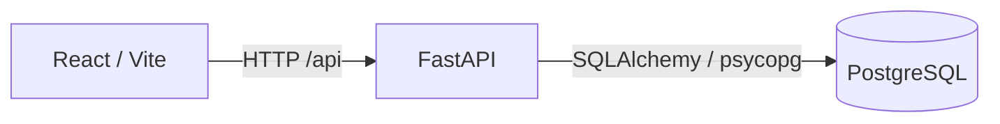

# AgentGuard

AgentGuard is an AI agent evaluation and observability platform. It is designed to answer whether an agent performed the right actions, not merely whether it produced a convincing final message.

## Phase 1

This first phase establishes the smallest working system:

- FastAPI backend with `/api/health` and `/api/ready`
- PostgreSQL 16 service with a persistent Docker volume
- React + TypeScript + Vite frontend
- Docker Compose orchestration
- Environment-based configuration
- Browser-to-API-to-database health verification

Agent runtime, trace collection, deterministic evaluation, policies, and run visualizations are deliberately deferred to later phases.

## Architecture



## Run locally

Prerequisites: Docker Desktop with Compose.

```bash
cp .env.example .env
docker compose up --build
```

Open:

- Frontend: http://localhost:5173
- Backend API: http://localhost:8000
- API docs: http://localhost:8000/docs
- Health: http://localhost:8000/api/health

The frontend status panel should report both the API and database as healthy.

## Local development without Docker

Backend:

```bash
cd backend
python -m venv .venv
.venv\\Scripts\\activate
pip install -r requirements.txt
uvicorn app.main:app --reload
```

Frontend:

```bash
cd frontend
npm install
npm run dev
```

The backend expects PostgreSQL at the `DATABASE_URL` in `.env`.

## Next phase

Phase 2 will add the mock customer-support agent and least-privilege tool system. All agent behavior will be routed through an abstraction so a provider such as Google ADK can be introduced without changing the API or UI contracts.
