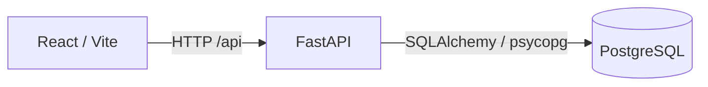

# AgentGuard

AgentGuard is an AI agent evaluation and observability platform. It is designed to answer whether an agent performed the right actions, not merely whether it produced a convincing final message.

## Phase 1

This first phase establishes the smallest working system:

- FastAPI backend with `/api/health` and `/api/ready`
- PostgreSQL 16 service with a persistent Docker volume
- React + TypeScript + Vite frontend
- Docker Compose orchestration
- Environment-based configuration
- Browser-to-API-to-database health verification

Agent runtime, trace collection, deterministic evaluation, policies, and run visualizations are deliberately deferred to later phases.

## Architecture



## Run locally

Prerequisites: Docker Desktop with Compose.

```bash
cp .env.example .env
docker compose up --build
```

Open:

- Frontend: http://localhost:5173
- Backend API: http://localhost:8000
- API docs: http://localhost:8000/docs
- Health: http://localhost:8000/api/health

The frontend status panel should report both the API and database as healthy.

## Local development without Docker

Backend:

```bash
cd backend
python -m venv .venv
.venv\\Scripts\\activate
pip install -r requirements.txt
uvicorn app.main:app --reload
```

Frontend:

```bash
cd frontend
npm install
npm run dev
```

The backend expects PostgreSQL at the `DATABASE_URL` in `.env`.

## Phase 3 — execution tracing

The application now includes persistent execution tracing for agent tasks and tool calls.

- Trace persistence model with ordered spans and parent-child execution relationships
- Redacted payload sanitization for secrets and sensitive values
- Trace API endpoints for list/detail/span retrieval with filtering and pagination
- Demo trace generation for one successful and one failed execution path
- React trace explorer UI with status filters, timeline details, and payload inspection

The backend exposes tracing endpoints on `/api/traces`, `/api/traces/{trace_id}`, `/api/traces/{trace_id}/spans`, plus `/api/demo/traces` to generate sample executions.

## Phase 4 — evaluation engine

This phase adds evidence-based evaluation over persisted traces rather than relying on final text or a single success flag.

- Modular evaluator framework for task success, tool appropriateness, argument validation, efficiency, recovery, and safety policy checks
- Configurable evaluation criteria and weightings stored in the database
- Persisted evaluation records with findings, score breakdowns, and overall status
- Backend endpoints for listing configs, running evaluations, and retrieving prior evaluation results
- React dashboard support for evaluating selected traces and reviewing finding details

Core evaluation routes:

- `GET /api/evaluation-configs`
- `POST /api/evaluation-configs`
- `GET /api/traces/{trace_id}/evaluations`
- `POST /api/traces/{trace_id}/evaluate`
- `GET /api/evaluations`
- `GET /api/evaluations/{evaluation_id}`

## Current status

AgentGuard now provides:

- a working FastAPI backend
- a persistent trace store and trace explorer UI
- a modular evaluation engine backed by real execution data
- a frontend dashboard for reviewing traces and running evaluations

## Next phase

Planned follow-up work includes amplifying the evaluation dashboard with aggregate metrics, benchmark scenarios, and broader historical comparison views. The current implementation is already suitable for local evaluation workflows and iterative policy refinement.
